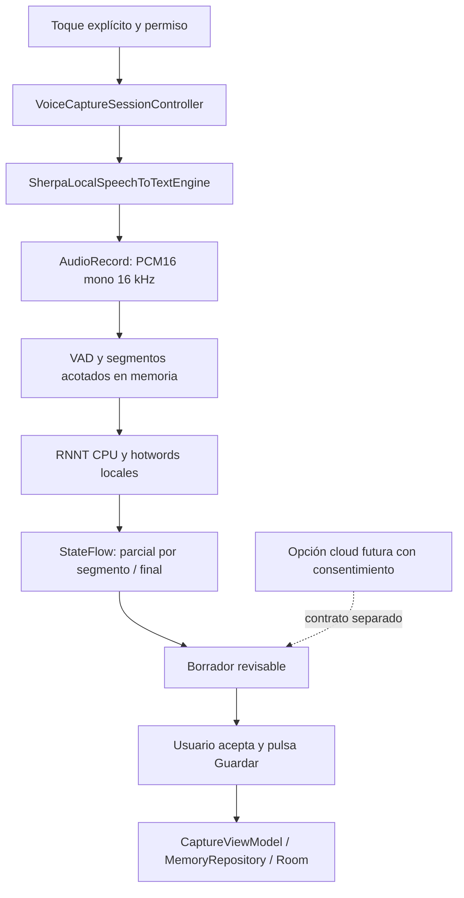

# F3.06 — Plan y preparación del motor STT local

**Fecha:** 2026-10-12. **Estado del documento:** plan de investigación y preparación redactado en esa fecha; las declaraciones de estado iniciales y las etapas futuras describen el momento de su elaboración.

> **Actualización 2026-10-14:** la vía Sherpa ASR-only autorizada posteriormente ya fue reconstruida e integrada con FastConformer RNNT int8 y Silero. La implementación, receta, hashes, licencias, pruebas, comparaciones y bloqueos actuales están en [F3.06 — reconstrucción de Sherpa sin TTS ni diarización](F3.06-runtime-asr-only.md) y en el [expediente reproducible](../INVESTIGACION/F3.06-asr-only/README.md). F3.06 sigue abierta: no se validó una transcripción humana en vivo por AudioRecord y la publicación sigue bloqueada por los gates indicados en el informe. Este plan conserva su investigación original y no sustituye esos resultados posteriores.

## 1. Alcance, proyecto y evidencia

Esta entrega ejecuta la planificación y preparación solicitadas. No modifica Kotlin de producción, Gradle, permisos, contratos, UI o schemas; no hace commit/push ni inicia F3.07. Los ejemplos descargados se conservan como texto y no se ejecutan. Las propuestas de las secciones siguientes son trabajo futuro, no funciones existentes.

### Requisitos refinados por el usuario

- Motor base siempre local e independiente de Google/Samsung; precisión en vocabulario especial mediante un mecanismo comprobable.
- Dispositivo objetivo comunicado: **Samsung Galaxy S24 Ultra**; RAM y versión Android/One UI no comprobadas. Priorizar **Pixel 8 AVD API 35**, con micrófono real del PC encaminado al emulador, para el prototipo.
- Extensión futura para **transcripción con IA cloud elegida explícitamente**. No es autorización para transmitir audio ahora ni para convertir el modo local en un fallback remoto. La investigación actual no envió audio, notas o transcripciones.
- Aún faltan ejemplos de términos especiales del usuario. El corpus inicial usará nombres y tecnicismos sintéticos; su calidad no representará el vocabulario personal hasta acordarlo.

### Auditoría mínima del proyecto

| Elemento | Estado observado |
|---|---|
| Android | `minSdk 24`, `compileSdk/targetSdk 37`, paquete `com.yezvi.assistant` |
| Herramientas | AGP **9.4.1**, Kotlin **2.2.10**, Gradle **9.6.0**, Java source/target **11**; no se cambian |
| Persistencia | Room 3 **3.0.3**, KSP2 **2.3.12**, SQLite **2.7.1**; fuera de este trabajo |
| F3.03 | `SpeechToTextEngine`, `StateFlow`, parciales/finales, errores tipados y exclusión de sesiones presentes; contrato exige procesamiento local |
| F3.04 | `RECORD_AUDIO` y permiso contextual presentes; denegación/revocación/Ajustes ya modelados |
| F3.05 | `VoiceCaptureSessionController` presente; serializa comandos, comprueba permiso, finaliza/cancela y cierra la sesión |
| F3.06 nativa | Factory exclusivamente on-device; AVD devolvió `ERROR_LANGUAGE_NOT_SUPPORTED` para `es-PE`, sin iniciar captura ni transcribir |
| Capturar | Borrador textual, revisión y guardado real existentes; control de voz actual solo gestiona permiso, no incorpora el motor |
| Red | Manifest actual **sin `INTERNET`**. El AAR sherpa inspeccionado tampoco añade permisos |

No falta un prerrequisito contractual o de permiso imprescindible. La ausencia de modelo español en el servicio del AVD justifica un runtime empaquetado; no demuestra un fallo de micrófono ni incompatibilidad del S24 Ultra. F3.01/F3.02 son antecedentes históricos: la oferta Moonshine streaming española cambió y se revisa aquí sin reescribir esas entregas.

## 2. Investigación y comparación de candidatos

**MB = 1.000.000 bytes.** Tamaño de descarga, archivos requeridos y RAM son magnitudes distintas. No se ejecutaron inferencias, benchmarks, audio o builds en esta entrega.

| Candidato fijable | Español / modalidad | Tamaño comprobado | Vocabulario especial y calidad | Compatibilidad / mantenimiento |
|---|---|---|---|---|
| **sherpa 1.13.8 + FastConformer español RNNT int8** | Español; ASR **offline por segmentos**, aunque la arquitectura sea transducer | Tar **107.246.685 B**; encoder/decoder/joiner/tokens **136.488.391 B** extraídos | Sesgo contextual por stream, beam search y vocabulario BPE. WER del original publicado, no del port int8 ni de términos del usuario | AAR minSdk 21; Kotlin/JNI/CPU, ARM64 y x86_64 presentes. Reutiliza contratos; candidato principal |
| **Moonshine Voice 0.1.5, Spanish Tiny/Small Streaming** | Español; streaming incremental real | Tiny **32.316.573 B**, Small **121.800.392 B**; AAR **24.321.396 B** | `keyterms`, fuerza de sesgo y contexto local; nuevos pesos MIT. Evaluación específica LatAm espontánea ausente | SDK Android oficial **minSdk 26**, incorpora dependencias/descargas/permisos de red. Requiere decisión adicional para YEZVI API 24 |
| **sherpa + Moonshine Spanish Base anterior** | Offline, streaming simulado con VAD | Tar **50.846.902 B**; upstream legacy ~64,8 MB | Community License; no trasladar MIT de los streaming nuevos. Sin hotwords de transducer | Compatible mediante sherpa, pero no cubre bien el requisito de términos ni evita condiciones de licencia |
| **sherpa + Whisper base int8 multilingüe** | Offline por segmentos | Archivos necesarios **160.609.290 B** | Pesos MIT; sherpa 1.13.8 **no expone prompt/hotwords para Whisper**. Sirve como baseline | Mismo AAR; simple para comparación. No usar `.en`; `es-PE` se traduce a `language="es"` |
| **whisper.cpp 1.9.5 + small Q5_1 multilingüe** | Offline por ventanas/segmentos | Modelo **190.085.487 B** | Prompt textual con nombres; no es un diccionario garantizado. Calidad de esa cuantización en nuestro corpus pendiente | Código/pesos MIT. Ejemplo Java minSdk 21; Kotlin minSdk 26. Requiere JNI propio para español/prompt/cancelación; más mantenimiento nativo |
| **Vosk Android 0.3.75 + small-es 0.42** | Streaming real, offline | ZIP **39.817.833 B** | Gramáticas y adaptación de vocabulario. Palabras fuera del diccionario pueden requerir reconstrucción; gramática cerrada limita dictado libre | Apache-2.0; demo Android existente. Alternativa ligera si prima latencia sobre dictado libre |
| **sherpa + Kroko Zipformer español 2025-08-06** | Streaming real, hotwords | Tar **124.394.665 B** | Mecanismo contextual apropiado; calidad local pendiente | Checkpoint convertido sin trazabilidad de licencia suficiente; no seleccionar para distribución |

Fuentes de tamaños/versiones: [sherpa release 1.13.8](https://github.com/k2-fsa/sherpa-onnx/releases/tag/v1.13.8), [inventario oficial de modelos](https://api.github.com/repos/k2-fsa/sherpa-onnx/releases/tags/asr-models), [Whisper base fijado](https://huggingface.co/csukuangfj/sherpa-onnx-whisper-base/tree/bb53ee204431c90d314c1cc08d28d23e5b7927cc), [Moonshine catálogo 0.1.5](https://github.com/moonshine-ai/moonshine/blob/v0.1.5/core/moonshine-model-catalog.cpp), [metadata de archivos Moonshine](https://github.com/moonshine-ai/moonshine/blob/v0.1.5/core/moonshine-model-file-metadata.generated.cpp), [whisper.cpp release](https://github.com/ggml-org/whisper.cpp/releases/tag/v1.9.5), [pesos whisper.cpp](https://huggingface.co/ggerganov/whisper.cpp/tree/main), [Vosk modelos](https://alphacephei.com/vosk/models), [demo Vosk con versión Android](https://github.com/alphacep/vosk-android-demo/blob/a5e58ec399135f78325bd3e289849fc3fb57ce96/app/build.gradle).

### Precisión y rendimiento: qué evidencia existe

- **FastConformer original español:** NVIDIA publica WER transducer greedy, sin puntuación/capitalización, **4,99% MCV12 test**, **3,76% MLS test**, **15,01% Fisher test**, **5,72% VoxPopuli test**. El original es de aproximadamente 115 M parámetros y advierte degradación con tecnicismos/acentos. Es evidencia española de varios corpus; no certifica notas peruanas, nombres, cuantización ni nuestro decoder contextual. [Model card NVIDIA fijada](https://huggingface.co/nvidia/stt_es_fastconformer_hybrid_large_pc/blob/d3fcff82e2ddec13517256402aa5da86400c5893/README.md); copia consultada en `../INVESTIGACION/F3.06-stt-local/nvidia-spanish-model-card.md`.
- **Moonshine streaming español:** las tarjetas incluyen entrenamiento argentino/chileno/colombiano, pero no evaluación de habla espontánea latinoamericana. Los WER publicados Tiny **6,218%** y Small **4,938%** proceden de muestras de habla leída; no se comparan numéricamente con NVIDIA por ser protocolos distintos. [Tiny español](https://huggingface.co/moonshine-ai/moonshine-streaming-tiny-es/tree/215dc49e20d2efcfc438cd788b02920639bd85a0), [Small español](https://huggingface.co/moonshine-ai/moonshine-streaming-small-es/tree/8cb0974f29ca24d6b645518c430efc8c57cd0073), [metodología](https://moonshine-voice.readthedocs.io/en/latest/models/accuracy/).
- **Moonshine latencia publicada:** 92 ms Tiny / 234 ms Small en Pixel 10a para **inglés**, desde endpoint del segmentador hasta resultado. No mide español ni Pixel 8/S24 Ultra y excluye la espera previa del endpoint. [Tabla](https://moonshine-voice.readthedocs.io/en/latest/moonshine-vs-whisper/), [método](https://moonshine-voice.readthedocs.io/en/latest/using/benchmarks/).
- **Vosk small español:** WER publicado 16,02% CV / 16,72% mTEDx / 11,21% MLS. El catálogo estima ~300 MB de memoria para modelos pequeños en general, no para nuestra integración concreta. [Catálogo oficial](https://alphacephei.com/vosk/models).
- **Mediciones YEZVI:** ninguna de ASR alternativo, RAM, CPU, batería, WER, parciales o latencia. Tampoco existe prueba Samsung. No extrapolar VRAM/A100 de Whisper Python a ONNX CPU Android. [Whisper upstream](https://github.com/openai/whisper#available-models-and-languages).

Canary 180m y Nemotron 0.6B siguen siendo referencias de F3.02, pero no aportan una integración de vocabulario más simple para este primer prototipo. Nemotron supera 200 MB: no se descargó. No se investigaron nuevos frameworks de servidor.

### Proyectos abiertos que implementan términos propios

1. **sherpa-onnx, Apache-2.0:** ejemplo NeMo offline compara sin/con hotword la grafía **Phebe → Phoebe**. Es un modelo inglés Parakeet distinto; demuestra la técnica y el API, no calidad española. El código NeMo RNNT comparte ContextGraph, soportado en la release elegida. [Ejemplo fijado](https://github.com/k2-fsa/sherpa-onnx/blob/v1.13.8/nodejs-addon-examples/test_asr_non_streaming_nemo_parakeet_tdt_v2_hotwords.js), [implementación RNNT](https://github.com/k2-fsa/sherpa-onnx/blob/v1.13.8/sherpa-onnx/csrc/offline-recognizer-transducer-nemo-impl.h), [hotwords](https://k2-fsa.github.io/sherpa/onnx/hotwords/index.html).
2. **Moonshine Voice, MIT para streaming:** publica implementación, scripts y experimentos de keyterms. En inglés leído, Tiny redujo error de términos de 13,02% a 10,09% con boost 2, mientras empeoró ligeramente el resto; muestra por qué medir falsas inserciones. No se atribuye ese resultado al español. [Guía 0.1.5](https://github.com/moonshine-ai/moonshine/blob/v0.1.5/docs/models/domain-customization.md), [API Java](https://github.com/moonshine-ai/moonshine/blob/v0.1.5/language-bindings/android/java/main/java/ai/moonshine/voice/Transcriber.java).
3. **whisper.cpp, MIT:** CLI admite `--prompt`, idioma y cancelación cooperativa del core. Los ejemplos Android no exponen todo ese control: necesitarían adaptación JNI. Es referencia útil si RNNT falla calidad, con coste de mantenimiento explícito. [Header 1.9.5](https://github.com/ggml-org/whisper.cpp/blob/v1.9.5/include/whisper.h), [CLI](https://github.com/ggml-org/whisper.cpp/blob/v1.9.5/examples/cli/cli.cpp), [ejemplo Java API 21](https://github.com/ggml-org/whisper.cpp/blob/v1.9.5/examples/whisper.android.java/app/build.gradle).
4. **Vosk, Apache-2.0:** adaptación de diccionario/modelo lingüístico documentada; añadir palabras realmente ausentes no equivale a pasar una lista al decoder. Útil para comandos restringidos, menos directo para memorias libres. [Adaptación oficial](https://alphacephei.com/vosk/lm).

Ninguno de esos proyectos demuestra todavía alta precisión en el vocabulario particular del usuario sobre S24 Ultra. No se promete que una opción cloud sea necesariamente más precisa: se comparará sobre el mismo corpus si se habilita posteriormente.

## 3. Solución principal recomendada

**AudioRecord → Silero VAD local → sherpa-onnx 1.13.8 / ONNX Runtime 1.28.2 CPU → FastConformer español RNNT int8, con hotwords por sesión → borrador revisable.**

Se selecciona esta arquitectura para implementar primero: mantiene API 24, dispone de artefacto oficial verificado, binding Kotlin ya publicado y un decoder capaz de favorecer palabras/frases especiales. El modelo español tiene evidencia upstream y una licencia identificada. La selección queda sujeta a la puerta de calidad/latencia real; no es una afirmación de superioridad medida.

**Es reconocimiento por segmentos**, con actualizaciones al completar frases; no streaming acústico incremental. Dos hilos CPU son un punto de partida a medir. El número de parámetros, pesos int8 y sesgo contextual no garantizan tiempo real ni nombres correctos.

Moonshine **Small Streaming español** merece segunda evaluación si se acepta explícitamente una estrategia para API 26 y se eliminan rutas de descarga/red del SDK. Su streaming y keyterms son ventajas reales. No elevar minSdk ni usar `overrideLibrary` en esta entrega. [Build 0.1.5](https://github.com/moonshine-ai/moonshine/blob/v0.1.5/language-bindings/android/build.gradle.kts), [manifest y descargas](https://github.com/moonshine-ai/moonshine/blob/v0.1.5/language-bindings/android/java/main/AndroidManifest.xml).

Whisper base descargado queda **solo para comparación**, sin incorporarlo a la APK recomendada. El modelo sherpa Whisper no tiene sesgo de vocabulario; cambiar de tamaño no añade esa función. [Configuración Whisper fijada](https://github.com/k2-fsa/sherpa-onnx/blob/v1.13.8/sherpa-onnx/csrc/offline-whisper-model-config.h).

### Configuración propuesta para términos

- Snapshot pequeño de frases autorizadas al iniciar; primera prueba con lista sintética. Inyectarla como configuración interna del engine, sin añadir campos a `SpeechToTextRequest` ni crear almacenamiento de vocabulario.
- `OfflineModelConfig` contiene `transducer=OfflineTransducerModelConfig(encoder, decoder, joiner)` y los campos `modelType="nemo_transducer"`, `modelingUnit="bpe"`, `tokens`, `bpeVocab`, `numThreads=2`, `provider="cpu"`, `debug=false`. `OfflineRecognizerConfig` contiene ese modelo y `FeatureConfig(sampleRate=16000, featureDim=80)`.
- `decodingMethod="modified_beam_search"`, `maxActivePaths=4`; comparar sin sesgo y puntuaciones 1 / 1,5 / 2. Son ajustes de experimento, no optimización ya validada.
- Crear stream con frases separadas por `/`, mediante `createStream(hotwords)`. Rechazar delimitadores reservados `/` y `:` en términos del usuario y términos no representables: el API no documenta un mecanismo de escape. No enviar listas de nombres a MCP/cloud.
- El paquete no contiene `bpe.vocab`. Se preparó desde `tokens.txt` usando la regla del ejemplo oficial: token + TAB + `-1.0`, UTF‑8/LF. **1.025 filas**, hash registrado. Debe probarse su tokenización española: esta aproximación de longest-match no prueba equivalencia con el Unigram original.
- No corregir automáticamente por distancia de edición después del ASR. Favorecer una palabra en el decoder sigue requiriendo evidencia acústica; probar frases donde esa palabra **no** se pronuncia.

API/ejemplo de referencia: [Kotlin 1.13.8](https://github.com/k2-fsa/sherpa-onnx/blob/v1.13.8/sherpa-onnx/kotlin-api/OfflineRecognizer.kt), [NeMo contextual](https://github.com/k2-fsa/sherpa-onnx/blob/v1.13.8/nodejs-addon-examples/test_asr_non_streaming_nemo_parakeet_tdt_v2_hotwords.js). No se ejecutaron esos ejemplos remotos.

## 4. Arquitectura e integración propuesta

### Paquetes y archivos futuros

Rutas relativas a `app/src/main/java/com/yezvi/assistant/`, salvo indicación:

| Archivo propuesto | Responsabilidad |
|---|---|
| `data/speech/SherpaLocalSpeechToTextEngine.kt` | Implementa el contrato existente; sesión única, estados y errores |
| `data/speech/AudioRecordPcmSource.kt` | Captura PCM y recurso Android; puerto interno mínimo para fake de tests |
| `data/speech/SherpaOfflineRecognizerAdapter.kt` | Configuración/JNI/streams/VAD y liberación; permite probar lifecycle sin cargar modelos en JVM |
| `data/speech/LocalSpeechModelFiles.kt` | Inventario/hash, preparación atómica de archivos bajo `noBackupFilesDir/stt/<digest>/` |
| `data/speech/LocalSpeechModelSpec.kt` | Descriptor interno de archivos/digests/idioma/decoder; solo crearlo si evita constantes duplicadas |
| `presentation/capture/VoiceCaptureSessionController.kt` | Reutilizar; modificar únicamente si una incompatibilidad real aparece en tests |
| `presentation/capture/…` y `ui/screens/CaptureScreen.kt` | Propietario de sesión/borrador y controles mínimos posteriores, coordinados con OpenCode; no rediseño |
| `app/src/main/assets/stt/nemo-es-rnnt-int8/` | Pesos y vocabularios de la distribución elegida, futura incorporación |
| `app/src/main/assets/stt/licenses/` | Avisos del modelo/runtime/terceros y registro de conversión/cuantificación |

No crear módulos, DI, repositorios ASR ni capas de almacenamiento nuevas. Room no recibe audio ni estados STT.

### Captura y buffers

Formato propuesto: **PCM16 firmado mono, 16.000 Hz**, origen inicial `MIC`. Consultar `getMinBufferSize`, validar `STATE_INITIALIZED` y grabación efectiva. Buffer nativo inicial `max(minBufferSize × 2, 6.400 bytes)`; lectura de 320 muestras/20 ms, aceptando lecturas parciales. `getMinBufferSize` devuelve bytes y no garantiza continuidad bajo carga; `READ_BLOCKING` y `stop()/release()` están disponibles en el mínimo actual. [AudioRecord oficial](https://developer.android.com/reference/android/media/AudioRecord).

Convertir cada muestra a float mediante `short / 32768.0f`. Mantener acumulador para ventanas VAD de 512 muestras; no descartar sobrantes. Si 16 kHz no funciona, fallar honestamente en el prototipo; no pasar 48 kHz etiquetado como 16 kHz. Una ruta de resampling sería una tarea explícita con tests.

Propuesta inicial: VAD con cola de silencio ~500 ms, pre-roll ~200 ms y tope de segmento **15 s**. Son valores a ajustar con habla real. Completar el segmento final al detener, incluso sin silencio; probar palabras cortadas en el límite duro. No aplicar deduplicación textual heurística que borre repeticiones pronunciadas. Si se necesita solapamiento, verificar offsets y conciliación antes de activarlo.

Cola de inferencia ordenada, con máximo inicial de dos segmentos pendientes más el actual. No descartar audio silenciosamente ni mantener RAM sin límite si ASR es más lento: detener entrada y reportar fallo recuperable si se rebasa el presupuesto. PCM float de 15 s ocupa 960.000 bytes; este cálculo **no** incluye tensores, modelos ni memoria del runtime. Audio solo en memoria, sin WAV persistente en la ruta local.

### Hilos, sesiones y limpieza

1. `start()` comprueba permiso, español y exclusión mutua; publica `Preparing`, crea identidad de sesión y lanza preparación en background, devolviendo pronto. Evita mantener ocupado el mutex del controlador durante carga/inferencia.
2. Copia/hash de archivos en IO; JNI/ASR en un worker serial; `AudioRecord.read` en otro worker de IO. Nunca carga/decodifica en main. Usar corrutinas existentes, sin nueva dependencia de scheduling.
3. Publicar `Listening` cuando la captura realmente arranca. Idioma local `es` admite solicitudes españolas como `es-PE`, pero eso no certifica acento peruano. Para la familia RNNT no usar el parámetro Whisper `language`.
4. VAD finaliza segmentos; una sola inferencia los procesa por secuencia. `Listening(PartialTranscript)` puede mostrar concatenación de segmentos ya decodificados. Se etiqueta como progreso por frases, no hipótesis incremental del audio aún abierto.
5. `finish()` idempotente solicita cortar micrófono, publica `Transcribing`, programa el drenaje en el worker y **devuelve pronto**: `controller.stop()` mantiene su mutex mientras llama a `engine.finish()`, por lo que esperar toda la inferencia impediría cancelar/cerrar. El worker drena muestras/cola, libera streams/VAD/modelo y solo entonces emite `Result`. Primer prototipo corto puede declarar `supportsPartialResults=false`; activar parciales cuando la etapa de segmentación se pruebe.
6. `cancel()` invalida sesión, detiene micrófono, elimina cola y descarta resultados. Una llamada JNI `decode` puede no interrumpirse por cancelar una corrutina: **no liberar el reconocedor mientras ejecuta**, ni prometer cancelación instantánea de CPU. Esperar su salida y cleanup suspendiendo fuera de main; **no retornar de `cancel()` hasta liberar recursos**, pues el controlador publicaría inmediatamente `Cancelled`. Rechazar nuevas sesiones hasta terminar. Si ese tiempo incumple aceptación, cambiar de runtime/modelo.
7. `try/finally`, limpieza idempotente y `CancellationException` propagada; usar `NonCancellable` solo para cleanup. Descartar resultados de sesiones invalidadas y no compartir reconocedor entre workers.
8. Liberar recursos antes de **cada** estado terminal. No dejar modelo cacheado después de `Result`: `controller.close()` no llama `engine.cancel()` cuando ya está inactivo y el contrato no ofrece `close()` separado. Optimizar caché solo después de diseñar su propietario explícito.

Referencia de captura, no código para copiar sin adaptar: [VadAsr Android 1.13.8](https://github.com/k2-fsa/sherpa-onnx/blob/v1.13.8/android/SherpaOnnxVadAsr/app/src/main/java/com/k2fsa/sherpa/onnx/MainActivity.kt). Sus lanzamientos concurrentes no resuelven nuestro orden/cancelación.

### Permisos, lifecycle y errores

Permiso solo tras toque; concederlo no inicia por sí mismo una grabación. Comprobar antes/después de preparar y ante revocación. La pantalla cancela al salir de Capturar o perder el estado activo; observar StateFlow con lifecycle no sustituye detener el micrófono. No servicio foreground, escucha permanente ni permiso nuevo. Una denegación sigue permitiendo escritura textual. Android puede terminar el proceso al revocar: recuperación siempre como sesión terminada. [Permisos Android](https://developer.android.com/training/permissions/requesting).

En API 29+ observar además captura silenciada por el sistema cuando corresponda; permiso concedido no garantiza señal útil. Modelar usando los errores actuales, sin duplicarlos:

| Situación | Contrato existente |
|---|---|
| ABI/JNI/runtime no disponible | `EngineUnavailable` |
| Pesos ausentes/incompletos o hash distinto | `OfflineModelMissing` |
| `RECORD_AUDIO` denegado/revocado | `PermissionDenied` |
| Solicitud no española | `RecognitionFailed(LANGUAGE_NOT_SUPPORTED)` |
| No voz/resultado vacío | `RecognitionFailed(NO_SPEECH)` |
| Error de AudioRecord/señal bloqueada/cola excedida | `RecognitionFailed(AUDIO_CAPTURE)`; explicación de UI sin texto privado |
| Nueva sesión mientras otra se limpia | `SessionAlreadyActive`, sin reemplazar estado |
| Fallo inesperado de inferencia | `RecognitionFailed(UNKNOWN)` |

No registrar muestras, transcripción, vocabulario personal o excepción con esos datos en logs; `debug=false`. Diagnóstico solo estado/código/duración/bytes. Sin fallback cloud.

### Borrador y memoria

El resultado final es texto candidato en memoria. El usuario elige aplicarlo al borrador; jamás reemplazar automáticamente un borrador textual ya existente. No normalizar ni guardar en esta tarea. Para la integración posterior: conservar el contexto temporal al empezar captura efectiva (UTC en **milisegundos**, zona IANA), origen `VOICE`; revisar texto y guardar mediante el `CaptureViewModel` existente, que mantiene ID durante reintento. `rawText` persistido es el **texto aceptado**, como ya exige arquitectura F1/F2. El audio no pasa a Room; las correcciones siguen F2 sin cambiar originales.

### Extensión cloud solicitada: diseño futuro, separada de la base local

El contrato `SpeechToTextEngine` explícitamente prohíbe upload y `docs/ARQUITECTURA.md` describe STT local. **No añadir un adapter cloud que finja cumplirlo.** La nueva preferencia del usuario se registra como propuesta de una ruta opcional futura; antes de implementarla habrá que revisar el contrato remoto y la política/ADR correspondientes.

Punto de extensión propuesto: orquestador de presentación con modo local por defecto y un `CloudSpeechTranscriber` independiente, solo cuando exista autorización para esa implementación. Selector explícito; ningún error local cambia de modo. Elegir proveedor después de revisar español, vocabulario adaptado, coste, retención y credenciales; no fijar una API ni afirmar mayor precisión sin comparar.

La vía remota necesita consentimiento informado para **ese audio**, proveedor y términos que saldrán; si debe comparar la misma grabación, el usuario activa retención temporal **antes** de capturar. La ruta local actual descarta PCM, así que no podría recuperar mágicamente audio antiguo. Un futuro archivo temporal privado, excluido de backup y con eliminación por éxito/error/cancelación, requerirá diseño y pruebas. No incrustar claves maestras, añadir `INTERNET`, SDK HTTP, backend o telemetría ahora. Si se rechaza cloud o no hay red, sigue disponible el motor local y el texto. Resultados cloud también serán propuestas revisables, sin sobrescribir el local aceptado ni Room.

## 5. Dependencias, distribución, tamaños y licencias

### Única dependencia de producción propuesta para la siguiente etapa

Artefacto oficial **`sherpa-onnx-static-link-onnxruntime-1.13.8.aar`**, con hash del manifest. Propuesta reproducible: incorporarlo después a `app/libs/` como dependencia de archivo exacta (`implementation(files("libs/sherpa-onnx-static-link-onnxruntime-1.13.8.aar"))`), con inventario de procedencia. **No se copió allí ni se editó Gradle.** No inventar coordenadas Maven ni usar `latest`; el AAR ya incluye bindings, no copiar las clases de ejemplo a producción.

Incluye ONNX Runtime **1.28.2**; no añadir `onnxruntime-android` encima. Fuentes de versión: [build ORT estático](https://github.com/k2-fsa/sherpa-onnx/blob/v1.13.8/cmake/onnxruntime-android-aarch64-static.cmake), [release](https://github.com/k2-fsa/sherpa-onnx/releases/tag/v1.13.8). El AAR descargado incluye ARM64, ARMv7, x86 y x86_64; en las dos ABIs de 64 bits ORT está dentro del JNI. La variante x86 también contiene `libonnxruntime.so`; no afirmar que todas las ABIs solo traen un `.so`.

Compatibilidad declarada e inspeccionada: AAR **minSdk 21**, minCompileSdk 1 y mínimo AGP 1.0.0; no exige cambiar herramientas actuales. JVM upstream 1.8 compatible por nivel de bytecode con Java11. **La combinación efectiva de Kotlin/AGP/API 24–37 aún necesita build y ejecución.**

### Distribución completamente local

Empaquetar modelo/VAD/vocabulario en assets antes de desconectar, sin downloader de producción. Prepararlos en IO bajo `noBackupFilesDir`, verificar hashes por archivo, escribir temporales y renombrar tras validación; abrir mediante `OfflineRecognizer(assetManager=null, config)`. No cargar modelos incompletos ni borrarlos junto con notas. El primer prototipo solo incluye un modelo.

Hay coste de almacenamiento por assets más copia extraída; no ocultarlo. Evaluar luego carga directa de assets si realmente funciona con el vocabulario/ORT y evita copia, con evidencia de memoria. APK/AAB por ABI y compresión se medirán al construir; no asumir que el tar comprimido predice APK final. ARM64 corresponde al objetivo Galaxy y x86_64 al AVD; evitar introducir filtros ABI hasta verificar cómo conservar dispositivos admitidos.

| Componente | Bytes verificados / licencia |
|---|---|
| Runtime AAR completo | **38.691.998 B** comprimidos; sherpa Apache-2.0, ORT MIT; conservar licencias de terceros |
| Biblioteca JNI ARM64 | **24.169.352 B** sin compresión, observada dentro del AAR |
| Modelo español requerido | **136.488.391 B**, sin VAD/vocabulario derivado; upstream NVIDIA **CC-BY-4.0** |
| Vocabulario BPE preparado | **11.981 B**, derivado local; conservar atribución y describir transformación |
| VAD sherpa/Silero | **643.854 B**, upstream MIT; identidad fijada por digest, no inferir una versión Silero desde el nombre |
| Base de archivos ARM64 | **161.313.578 B** de modelo + BPE + VAD + JNI, antes de APK/app/copias/tensores |

CC-BY-4.0 permite distribución con atribución, enlace a licencia e indicación de conversión/cuantificación. Incluir NVIDIA/modelo/origen, transformación de sherpa y avisos, sin atribuir a NVIDIA respaldo de YEZVI. No reutilizar licencias por analogía: el modelo multilingüe NGC y Moonshine legacy tienen términos distintos. [Modelo NVIDIA](https://huggingface.co/nvidia/stt_es_fastconformer_hybrid_large_pc), [licencia CC-BY-4.0](https://creativecommons.org/licenses/by/4.0/), [sherpa](https://github.com/k2-fsa/sherpa-onnx/blob/v1.13.8/LICENSE), [ORT](https://github.com/microsoft/onnxruntime/blob/v1.28.2/LICENSE), [Silero](https://github.com/snakers4/silero-vad/blob/1e261b036686cd0017d500ee96acd1c4ba572a9d/LICENSE).

RAM no se calcula a partir de pesos. Medir tensores/PSS/RSS/JVM/peak nativo, carga fría, CPU y energía en Galaxy. El emulador sirve para integración, no para certificar batería/latencia del S24 Ultra. Inicialmente sin NNAPI/NPU/GPU ni aceleración Samsung presumida.

**16 KB:** inspección estática real de los ELF ARM64/x86_64 descargados encontró `PT_LOAD.p_align=16.384`, con offsets congruentes. No equivale a APK ZIP alineado ni ejecución en dispositivo 16 KB. AGP actual supera el mínimo documental; comprobar APK con `zipalign -c -P 16` y dispositivo compatible en la implementación. [Android 16 KB](https://developer.android.com/guide/practices/page-sizes). R8 requiere conservar nombres JNI si se minifica; revisar `com.k2fsa.sherpa.onnx.**` y no asumir que las consumer rules vacías protegen bindings.

## 6. Recursos descargados y preparación realizada

**Ubicación local de binarios/pesos:** `C:\Users\Rick\Documents\GitHub\YEZVI\.gradle\yezvi-stt-research\`. Ignorada por Git; no se incorpora al build y puede perderse al limpiar cachés. No moverla a `app/libs`/assets hasta la etapa autorizada.

| Recurso | Preparación real |
|---|---|
| AAR sherpa estático 1.13.8 | Descargado; bytes y SHA-256 comparados con GitHub; ZIP/manifest/metadata/ELF inspeccionados sin ejecutarlo |
| Tar RNNT español int8 | Descargado; SHA-256 GitHub verificado; inventario inspeccionado antes de extraer únicamente los cuatro archivos requeridos |
| `bpe.vocab` | Generado como recurso de preparación desde tokens con regla del ejemplo; todavía sin prueba de tokenizer/inferencia |
| `silero_vad.onnx` | Descargado; checksum publicado verificado; no ejecutado |
| Whisper base int8, revisión `bb53ee…` | Descargado como baseline antes de concretar requisito de palabras; encoder/decoder verificados con SHA-256 LFS; tokens con hash local. No formar parte de la APK principal |
| 12 fuentes/licencias públicas | **154.395 B** en `docs/INVESTIGACION/F3.06-stt-local/`; originales conservados, versiones y hashes registrados, ningún script ejecutado |

Inventarios completos con **URL, versión, licencia, bytes, SHA-256, ubicación y base de verificación**:

- [recursos-manifest.json](../INVESTIGACION/F3.06-stt-local/recursos-manifest.json).
- [fuentes-manifest.json](../INVESTIGACION/F3.06-stt-local/fuentes-manifest.json).
- [inspeccion-aar.json](../INVESTIGACION/F3.06-stt-local/inspeccion-aar.json).

Checksums principales:

| Artefacto | SHA-256 verificado contra publisher |
|---|---|
| AAR sherpa | `b22c3fc1b6a45666d28892bb2f7694beeb77a8362d7ebd77c1a5431ec9435471` |
| Tar RNNT español | `d6d29ffd560c366da1b177b71e79d8733a9a9910dd1ace282d9bfae94e056210` |
| VAD | `9e2449e1087496d8d4caba907f23e0bd3f78d91fa552479bb9c23ac09cbb1fd6` |

Los hashes de fuentes ordinarias y componentes extraídos son locales; no llamarlos checksums independientes del publisher. GitHub ofrece digest del contenedor RNNT. Su script exportador usa `from_pretrained(model_name)` sin revisión: no garantiza reproducción binaria idéntica. Se fija el **artefacto descargado por digest**, y se registra la model card de origen por revisión; no se afirma conocer el commit exacto de pesos originales usado durante esa conversión.

Ningún modelo/paquete descargado supera **200.000.000 B**. No se descargó el tar Whisper base de **207.557.382 B**, modelos Nemotron, toolchains ni paquetes mayores. El tar RNNT contiene una muestra pública `es-spanish.wav`: se inventarió, pero no se extrajo, reprodujo ni utilizó, y no se incorpora a APK sin revisar su procedencia/licencia. No hay resultados de audio derivados de esa muestra.

## 7. Ejecución futura por etapas

Esta lista prepara el trabajo; **ninguna etapa de código se ejecutó hoy**. Mantener un solo dueño de cada archivo y revisar cualquier cambio público de contrato antes de aplicarlo.

| Etapa | Archivos afectados después de autorización | Dependencia y aceptación |
|---|---|---|
| 1. Runtime y modelo aislados | `app/libs/…1.13.8.aar`, cambio mínimo `app/build.gradle.kts`, assets/licencias, `LocalSpeechModelFiles`, prueba instrumentada de modelo | Usar inventarios actuales; generar build con stack intacto; hashes coinciden; carga RNNT en x86_64; prueba offline con fixture sintético autorizado; sin UI/Room |
| 2. Decoder y vocabulario | `SherpaOfflineRecognizerAdapter`, configuración interna, tests de BPE/hotwords | Sin/con sesgo sobre **mismo** audio español; acentos/Unicode/frases/nombres fuera de vocabulario; resultados y falsas inserciones registrados, no sustituciones posteriores |
| 3. AudioRecord y lifecycle | `AudioRecordPcmSource`, tests unitarios/instrumentados | Micro real tras toque; PCM correcto, lecturas parciales, permiso revocado, privacidad/silenciado, stop/cancel; liberación comprobada, sin archivos de audio locales |
| 4. Engine contractual | `SherpaLocalSpeechToTextEngine`, tests engine/controller existentes y nuevos | Preparing→Listening→Transcribing→Result; Error/Cancelled; doble toque, inicio durante cleanup, callbacks tardíos, cancellation segura; modelo no cacheado sin dueño |
| 5. Segmentos y parciales honestos | Adapter/engine/VAD y pruebas | Silencio, frase larga >30 s sin pérdidas, cola lenta, orden, último segmento al parar; después habilitar parciales por frases; memoria acotada |
| 6. Prototipo mínimo en YEZVI | Propietario de sesión en presentation, factory y controles mínimos `CaptureScreen`, strings y tests UI | Coordinación con OpenCode para enlace de voz de F3.08/F3.09 cuando se autorice; iniciar/detener/cancelar reales y aplicar final tras decisión; conservar borrador textual/revisión/guardado existente, sin rediseño ni normalización F3.07 |
| 7. Aceptación offline | Tests, evidencia y documentación | Abrir YEZVI, hablar al micrófono PC/Pixel, detener/cancelar/revisar; sin conectividad; confirmar frase, errores y cleanup. Guardado solo tras revisión explícita; regresión de Room intacta |
| 8. Rendimiento S24 Ultra | Evidencia/perfilado/documentación, ajustes mínimos si medidos | API/One UI/RAM registradas; métricas reales de corpus y sesiones; no aprobar rendimiento móvil a partir del AVD |

La primera acción de implementación es **etapa 1**, incorporando solo el AAR verificado y los assets RNNT/VAD, con un test de carga/inferencia aislado. No conectar UI hasta que ese modelo y el sesgo español funcionen. No iniciar F3.07 por completar esta planificación.

## 8. Pruebas y aceptación con micrófono real

### Unitarias y pruebas instrumentadas futuras

- JVM con fuente PCM y adapter falsos deterministas: transiciones completas, doble start/finish, stop durante preparación, cancelación durante JNI simulada, resultado tardío, cierre, permiso y revocación, cleanup único, propagación de `CancellationException`, orden de segmentos, backpressure y ausencia de éxito vacío.
- Archivos: hash incorrecto/modelo ausente/copia interrumpida, sin tocar directorios de Room; vocabulario estable, Unicode/tildes, tokens no representables y delimitadores reservados.
- Instrumentadas: carga **JNI/ONNX real**, inferencia con fixture español sintético autorizado, resultados RNNT sin/con vocabulario, falta de permiso, micrófono ocupado/silenciado, background, vuelta a pantalla y release; estas pruebas no sustituyen la frase humana.
- Ejecutar después de cambios: `.\gradlew.bat assembleDebug`, `.\gradlew.bat testDebugUnitTest`, `.\gradlew.bat connectedDebugAndroidTest`; informar cifras/fallos reales y probar build release si se altera packaging/R8. Conservar regresiones existentes, sin borrar datos personales.

### Procedimiento de micrófono PC → Pixel 8 API 35

1. Instalar APK del prototipo sin desinstalar ni `pm clear`; verificar AVD/ABI, permiso y modelo presente. Comprobar que el emulador recibe el **micrófono físico** seleccionado del host; no asumirlo por `android.hardware.microphone`. La disponibilidad depende de la configuración del AVD/host. [Controles extendidos Android Emulator](https://developer.android.com/studio/run/emulator-extended-controls).
2. Guardar estado de conectividad, activar modo avión y desactivar Wi‑Fi/datos del emulador; comprobar estado real. Ningún downloader/servicio de reconocimiento externo interviene. Para una prueba adicional estricta, desconectar también red del PC cuando las dependencias/modelos estén preparados.
3. Abrir YEZVI, entrar a Capturar, pulsar Inicio, hablar una frase sintética **en vivo** y detener. Ejemplo provisional: «Mañana revisaré el proyecto Aurora en Huaraz a las nueve». Comparar lo pronunciado y el texto local. Usar frases consentidas para YEZVI, KSP, Compose, topónimos y términos especiales cuando el usuario los concrete.
4. Repetir mismo corpus con vocabulario desactivado y activado; incluir negativos donde los nombres no se dicen, cifras/fechas, pausas, voz baja y ruido leve. Resultado final no vacío, sin inserciones de glosario injustificadas.
5. Probar cancelación durante escucha y transcripción, doble toque, salida de Capturar y revocación: sin nota guardada ni micrófono activo después. Abrir una nueva sesión y comprobar que no hereda voz/transcripción anterior.
6. Revisar y aceptar texto antes de Guardar. Comprobar origen VOICE/UTC milisegundos/zona/ID con los contratos existentes, y persistencia solo si se prueba esa integración autorizada.
7. Restaurar en `finally` la conectividad previa del emulador/host; no dejar modo avión activado inadvertidamente. Registrar fecha, dispositivo, modo local, audio humano sí/no, frase sintética autorizada y coincidencia; no publicar audio privado.

**Aceptación final funcional:** usuario habla mediante micrófono real, red desactivada, texto local corresponde a la frase, stop/cancel funcionan y la app deja revisar antes de guardar. WAV pregrabado, TTS, fake, feature de micrófono o suite verde no cierran esa puerta.

### Criterios de precisión y rendimiento propuestos, no mediciones

Preparar al menos 30 frases consentidas, con referencias manuales; repetir en condiciones controladas. Calcular WER/CER, acierto exacto de nombres/frases y falsas inserciones. Objetivo inicial para términos acordados en ambiente tranquilo: **≥95% de ocurrencias correctas**, con prueba negativa y sin empeorar WER general de forma relevante. Es un umbral a acordar, no una promesa del modelo ni sustituto de evaluar casos críticos individualmente. No comparar WER públicos de corpus distintos como ranking.

Objetivos provisionales: RTF sostenido <1; p95 del final <2 s después de Stop, excluyendo y reportando aparte carga fría; micrófono cerrado de inmediato al cancelar, tiempo de salida JNI medido; UI sin bloqueos. Medir carga fría/caliente, primer segmento, tiempo desde último sonido humano y desde endpoint por separado. Reportar mediana/p95 con suficientes repeticiones, tamaños APK/instalación, PSS/RSS/peak y uso CPU. Si incumple, acortar segmentos/ajustar hilos/sesgo solo con evidencia o pasar a alternativa.

Consumo/batería/temperatura se miden en **S24 Ultra físico**, con brillo/carga/ruido/duración controlados, comparando sesión fija y baseline. AVD Pixel no mide batería ni certifica rendimiento Samsung. Probar API 24 y 37/16 KB cuando existan equipos/imágenes; consignar ausencias sin inventar compatibilidad.

## 9. Riesgos, alternativas y rollback

| Riesgo | Acción / salida |
|---|---|
| Nombres propios o tecnicismos siguen fallando | Corpus específico y hotwords A/B; revisar representabilidad, fuerza y falsos positivos. Sin promesa de precisión perfecta |
| BPE derivado no reproduce segmentación Unigram | Probar español y frases; obtener vocabulario original trazable si hace falta. No asumir éxito del ejemplo inglés |
| Inferencia lenta/cancelación JNI no inmediata | Worker fuera de main y límites; medir. Si no cumple, evaluar Moonshine streaming o whisper.cpp con pruebas equivalentes |
| Streaming por segmentos parece escucha en vivo palabra a palabra | Etiquetas honestas, parciales solo de segmentos completos; no simular texto |
| RAM/almacenamiento/APK mayores de lo esperado | Medir release por ABI y primer uso; no entregar ambos modelos en el paquete; evitar audio/cachés sin dueño |
| Copia incompleta/modelo corrupto o falta de espacio | Hash y preparación atómica; error explícito, captura textual sigue disponible |
| AVD no recibe micrófono PC | Usuario habilita entrada física y permisos host; prueba no cerrada hasta voz en vivo; S24 Ultra es validación posterior |
| Licencias/terceros/conversión | Avisos y manifest fijados; conservar atribución, no ejecutar exportador con revisiones flotantes |
| Cloud altera privacidad de la base | Contrato separado y consentimiento por envío futuro; ninguna descarga/upload automática ni permiso de red ahora |

Rollback futuro: seleccionar de nuevo factory on-device o deshabilitar voz local alternativa, conservando captura textual; quitar AAR/assets/wiring en un cambio revisable. No cambiar ni borrar Room, notas, schemas o historial. Si falta modelo nativo español, mostrar indisponibilidad; nunca activar cloud como rollback.

**Conclusión:** recomendado sherpa **1.13.8 + FastConformer español RNNT int8 + hotwords locales + VAD**, con recursos verificados y un plan implementable. **F3.06 sigue pendiente**: no hubo inferencia, micrófono real, Samsung ni benchmark alternativo. No se ejecutó Gradle porque no se modificaron código/configuración de la aplicación. Siguiente paso autorizado a proponer: runtime/modelo aislados y prueba de vocabulario; después prototipo con micrófono real. No se avanzó F3.07.
